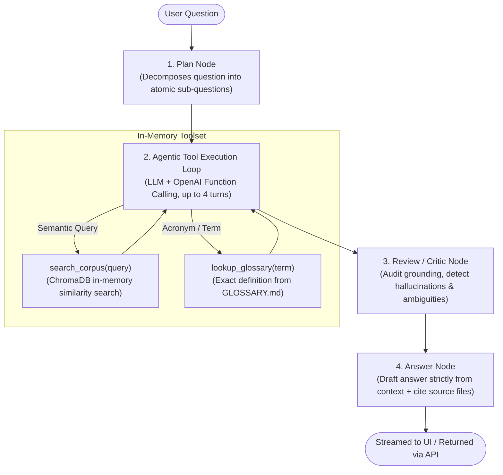

# 🩺 Syntax Pharma Research Agent

[](https://www.python.org/downloads/)
[](https://github.com/langchain-ai/langgraph)
[](https://fastapi.tiangolo.com/)
[](https://react.dev/)
[-purple.svg)](https://www.trychroma.com/)
[](https://www.docker.com/)

An autonomous **Agentic Research Assistant** in Python designed to answer complex, compound clinical questions over a local pharmacology corpus derived from FDA drug labels (**DailyMed**) and consumer medication monographs (**MedlinePlus**).

Built as part of the **Syntax Systems GenAI Bootcamp Technical Assignment**, this application implements a 5-stage agentic workflow orchestrated with **LangGraph**, dynamic tool calling, an in-memory vector database (**ChromaDB**), a strict clinical grounding auditor (**Critic**), and a real-time streaming **React 19** frontend.

> [!IMPORTANT]
> **Technical Exercise Disclaimer**: This system is a technical prototype developed for demonstration and assessment purposes only. It does not provide medical advice.

---

## 📑 Table of Contents

- [About the Application](#-about-the-application)
- [Agentic Architecture & Workflow](#-agentic-architecture--workflow)
- [Repository Structure](#-repository-structure)
- [Environment Configuration (.env)](#-environment-configuration-env)
- [How to Run the App](#-how-to-run-the-app)
  - [Option 1: Docker (Single Container - Recommended)](#option-1-docker-single-container---recommended)
  - [Option 2: Local Development (Backend + Frontend)](#option-2-local-development-backend--frontend)
- [How to Use the Application](#-how-to-use-the-application)
  - [1. Using the Web UI Dashboard](#1-using-the-web-ui-dashboard)
  - [2. Using the REST API Directly](#2-using-the-rest-api-directly)
  - [3. Running the Benchmark Evaluation Script](#3-running-the-benchmark-evaluation-script)
- [API Reference](#-api-reference)
- [Technical Rationale & Design Decisions](#-technical-rationale--design-decisions)
- [License & Disclaimer](#-license--disclaimer)

---

## 💡 About the Application

When clinicians or researchers examine complex pharmaceutical regimens, questions are rarely simple lookups. They typically involve:
- **Compound reasoning**: Comparing contraindications across multiple drugs (e.g., Warfarin vs. Apixaban).
- **Drug-drug interactions**: Detecting risks when drugs are co-prescribed (e.g., Warfarin + Sertraline).
- **Quantitative lab thresholds**: Checking strict clinical limits (e.g., Metformin contraindication when $\text{eGFR} < 30\text{ mL/min}$).

Standard RAG systems often suffer from hallucinations, context fragmentation, and ungrounded extrapolation. This assistant solves these issues with:
1. **Planning**: Decomposing compound questions into atomic search goals before querying.
2. **Autonomous Tool Selection**: Using LLM function calling to query the semantic monograph database (`search_corpus`) or the medical definitions glossary (`lookup_glossary`).
3. **In-Memory Semantic Search**: Vector embeddings stored in an ephemeral, in-memory ChromaDB instance with heading-aware chunking and drug-name preservation.
4. **Adversarial Critic**: Auditing retrieved passages against the original question to flag gaps, unsupported claims, or clinical ambiguities.
5. **Strict Grounding & Traceable Citations**: Citing exact local source files (`dailymed-*.md`) and cleanly refusing to answer if facts are not in the local corpus.
6. **Real-Time Token Streaming**: Streaming the live reasoning state and verified answer directly to an interactive React dashboard.

---

## 🏗️ Agentic Architecture & Workflow

The assistant's decision engine is modeled as a state machine using **LangGraph**:



### Detailed Workflow Stages

| Stage | Node Name | Description |
| :--- | :--- | :--- |
| **1. Plan** | `plan_node` | Evaluates the query and generates structured sub-questions or search steps. |
| **2. Retrieve & Tool Use** | `agent_tools_node` | Autonomously executes tool calls (`search_corpus` and/or `lookup_glossary`) across multiple turns until sufficient facts are collected. Includes an automatic fallback search if no tool is invoked on turn 1. |
| **3. Review (Critic)** | `review_node` | Audits the collected context against the user question to flag clinical ambiguities, ungrounded claims, or missing data points. |
| **4. Final Synthesis** | `answer_node` | Formulates the verified clinical response citing exact source files (e.g., `dailymed-warfarin.md`), noting any reviewer warnings, or strictly stating lack of corpus data if out-of-scope, followed by the mandatory medical disclaimer. |

---

## 📂 Repository Structure

```text
.
├── Dockerfile                  # Multi-stage build (Node 20 React build + Python 3.11 uv runtime)
├── README.md                   # Complete project documentation
├── .dockerignore               # Docker build exclusions
├── .gitignore                  # Git exclusions (.env, virtualenvs, local caches)
├── .env.example                # Environment variables template
│
├── agent-pharma/               # Backend Python application
│   ├── pyproject.toml          # uv / PEP 621 dependency specifications
│   ├── uv.lock                 # Pinned uv lockfile
│   ├── main.py                 # FastAPI application, CORS, and endpoint definitions
│   │
│   ├── app/                    # Agent orchestration and tools
│   │   ├── agent.py            # LangGraph StateGraph, nodes, and streaming generator
│   │   ├── config.py           # OpenAI / LiteLLM client initialization
│   │   ├── tools.py            # In-memory ChromaDB ingestion, search_corpus, lookup_glossary
│   │   └── test_eval.py        # Automated test script for evaluation questions
│   │
│   └── corpus/                 # Local curated pharmacology corpus
│       ├── GLOSSARY.md         # Clinical terminology definitions
│       ├── dailymed-*.md       # FDA drug labels (Warfarin, Apixaban, Metformin, etc.)
│       └── medlineplus-*.md    # Consumer medication information monographs
│
└── frontend/                   # React frontend application
    ├── index.html              # HTML shell with TailwindCSS styling
    ├── package.json            # Node dependencies (React 19, react-markdown, remark-gfm)
    ├── vite.config.js          # Vite configuration with local proxy to :8000
    └── src/
        ├── App.jsx             # Main research dashboard (streaming, stepper, question chips)
        ├── App.css             # UI styling & animations
        └── main.jsx            # React root mount
```

---

## ⚙️ Environment Configuration (.env)

The application reads credentials and model selections directly from environment variables. Copy the `.env.example` template to `.env` at the root of the repository:

```bash
cp .env.example .env
```

Configure your credentials inside `.env`:

```env
OPENAI_API_KEY=your_api_key_or_litellm_proxy_key
OPENAI_BASE_URL=https://your-litellm-proxy-url/v1
OPENAI_MODEL=gpt-4o-mini
OPENAI_EMBEDDING_MODEL=text-embedding-3-small
```

### Supported Providers
- **LiteLLM Proxy**: Set `OPENAI_BASE_URL` to your proxy endpoint (e.g., `https://.../v1`) and `OPENAI_API_KEY` to your proxy key.
- **Direct OpenAI**: Set `OPENAI_API_KEY` to your `sk-...` key (leave `OPENAI_BASE_URL` blank or point to `https://api.openai.com/v1`).

---

## 🚀 How to Run the App

### Option 1: Docker (Single Container - Recommended)

The repository provides a multi-stage `Dockerfile` that builds the React application, installs the Python environment via `uv`, and serves both the API and the compiled frontend from a single self-contained container.

#### 1. Build the Docker image
```bash
docker build -t agent .
```

#### 2. Run the Docker container
Pass your `.env` file into the container:
```bash
docker run -p 8000:8000 --env-file .env agent
```

#### 3. Access the app
- **Web Interface**: [http://localhost:8000](http://localhost:8000)
- **API Health Check**: [http://localhost:8000/health](http://localhost:8000/health)
- **Interactive Swagger Docs**: [http://localhost:8000/docs](http://localhost:8000/docs)

---

### Option 2: Local Development (Backend + Frontend)

To run the application locally without Docker:

#### Prerequisites
- **Python 3.11+**
- **[uv](https://docs.astral.sh/uv/)** (recommended) or `pip`
- **Node.js 20+** and `npm`

#### Step 1: Start the Backend (FastAPI)

1. Open a terminal and navigate to `agent-pharma/`:
   ```bash
   cd agent-pharma
   ```

2. Create and activate a virtual environment:
   - **Using uv (Recommended):**
     ```bash
     uv venv
     # Windows PowerShell:
     .venv\Scripts\Activate.ps1
     # Linux / macOS:
     # source .venv/bin/activate
     ```

3. Install dependencies:
   ```bash
   uv pip install -r pyproject.toml
   ```

4. Start the FastAPI server:
   ```bash
   uv run uvicorn main:app --reload --host 0.0.0.0 --port 8000
   ```
   *The server will index the markdown corpus in-memory upon startup and listen on port 8000.*

#### Step 2: Start the Frontend (React + Vite)

1. Open a second terminal and navigate to `frontend/`:
   ```bash
   cd frontend
   ```

2. Install dependencies:
   ```bash
   npm install
   ```

3. Start the development server:
   ```bash
   npm run dev
   ```

4. Open your browser at **[http://localhost:5173](http://localhost:5173)**.  
   *(Vite is pre-configured with a proxy that automatically forwards `/ask`, `/ask/stream`, and `/health` requests to `http://localhost:8000`).*

---

## 🖥️ How to Use the Application

### 1. Using the Web UI Dashboard

When you open the web application (`http://localhost:8000` in Docker or `http://localhost:5173` in local dev), you can:

1. **Ask a Custom Question**: Type any clinical inquiry into the search bar (e.g., *"What are the risks of combining warfarin with NSAIDs like ibuprofen?"*).
2. **Use Pre-loaded Evaluation Chips**: Click on any of the 4 benchmark buttons to test:
   - *Warfarin contraindications*
   - *Warfarin vs apixaban*
   - *Warfarin + sertraline*
   - *Metformin and eGFR 25*
3. **Watch the Live Reasoning Stepper**: As the agent works, a progress stepper illuminates in real time:
   - **Step 1: Plan** $\to$ Question decomposition
   - **Step 2: Retrieve & Tools** $\to$ Monograph search and glossary lookups
   - **Step 3: Review** $\to$ Critic verification for hallucinations or ambiguities
   - **Step 4: Answer** $\to$ Verified token streaming
4. **Copy Answer**: Use the one-click copy button to copy the cited answer.
5. **Theme Toggle**: Switch between dark and light modes with the header toggle.

---

### 2. Using the REST API Directly

You can interact with the backend using `curl` or any HTTP client:

#### Health Check
```bash
curl http://localhost:8000/health
```
**Response (`200 OK`):**
```json
{"status": "ok"}
```

#### Synchronous Question (`POST /ask`)
```bash
curl -X POST http://localhost:8000/ask \
  -H "Content-Type: application/json" \
  -d '{"question": "What are the main contraindications for warfarin?"}'
```
**Response (`200 OK`):**
```json
{
  "answer": "Based on the FDA drug label for Warfarin, the main contraindications include:\n\n1. Pregnancy: Warfarin is contraindicated in pregnancy (except in women with mechanical heart valves at high risk for thromboembolism) because it passes through the placental barrier and can cause fatal fetal hemorrhage and congenital malformations.\n2. Hemorrhagic tendencies or blood dyscrasias.\n3. Recent or contemplated central nervous system or ophthalmic surgery, or traumatic surgery resulting in large open surfaces.\n4. Bleeding tendencies associated with active ulceration or overt bleeding of gastrointestinal, genitourinary, or respiratory tracts.\n5. Threatening abortion, eclampsia, and preeclampsia.\n6. Inadequate laboratory facilities or uncooperative patients.\n7. Known hypersensitivity to warfarin or any component.\n\nSources:\n- dailymed-warfarin.md\n\nDisclaimer: This output is for informational purposes only and is not medical advice."
}
```

#### Real-Time Streaming (`POST /ask/stream`)
```bash
curl -N -X POST http://localhost:8000/ask/stream \
  -H "Content-Type: application/json" \
  -d '{"question": "What are the contraindications for warfarin?"}'
```
*Yields newline-delimited JSON (`application/x-ndjson`) with status step events followed by incremental token chunks.*

---

### 3. Running the Benchmark Evaluation Script

The project includes an automated test runner (`agent-pharma/app/test_eval.py`) that runs the 4 public evaluation questions against the running API:

1. Ensure the API is running on `http://localhost:8000`.
2. Run the test script:
   ```bash
   # From root or inside agent-pharma
   python agent-pharma/app/test_eval.py
   ```
   Or using `uv`:
   ```bash
   cd agent-pharma && uv run python app/test_eval.py
   ```

The script will:
- Check server health (`GET /health`).
- Benchmark each question sequentially.
- Report response latency, status codes, and the complete cited answer.

---

## 🔬 Technical Rationale & Design Decisions

### 1. LangGraph State Machine
Rather than relying on unstructured or opaque agent loops, **LangGraph** enforces an explicit state sequence:
$$\text{Plan} \longrightarrow \text{Use Tools} \longrightarrow \text{Review (Critic)} \longrightarrow \text{Synthesize Answer}$$
This provides predictable execution, deterministic context propagation, and clear debugging boundaries.

### 2. In-Memory Vector Store (ChromaDB)
- **Zero Disk Footprint**: Uses an ephemeral in-memory client (`chromadb.Client()`) as required by the specification.
- **Heading-Aware Enrichment**: Chunks are split on markdown headings (`## `) and automatically prefixed with the source document name and main title (e.g., `Document: dailymed-warfarin.md | # Warfarin...`). This eliminates ambiguity when sections share identical titles like `## CONTRAINDICATIONS`.
- **Rate Limit Resilience**: The embedding generator implements batched indexing with automated exponential backoff on HTTP 429 (`RateLimitError`), ensuring smooth cold starts even on rate-constrained LLM proxies.

### 3. Dedicated Critic Node
In clinical workflows, hallucinations can have severe consequences. The dedicated critic prompt acts as an independent auditor, verifying whether all elements of the answer are directly substantiated by retrieved text before drafting the final output.

### 4. Refusal on Out-of-Corpus Queries
If a query asks for information not present in the local corpus, the agent refuses to extrapolate, returning:
> *"The provided corpus does not contain information to answer this question. Sources: None"*

---

## ⚖️ License & Disclaimer

```text
Disclaimer: This output is for informational purposes only and is not medical advice.
```

Distributed under the MIT License for technical demonstration and assessment purposes.
